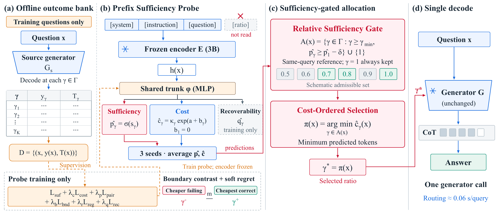
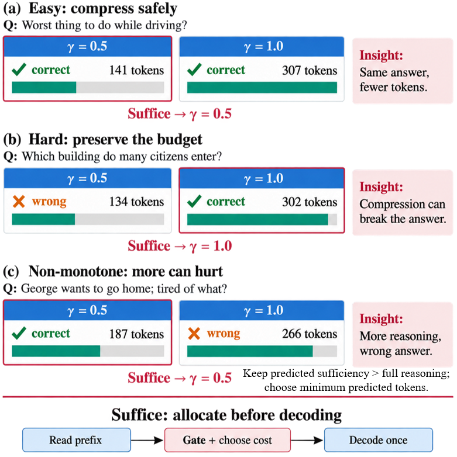
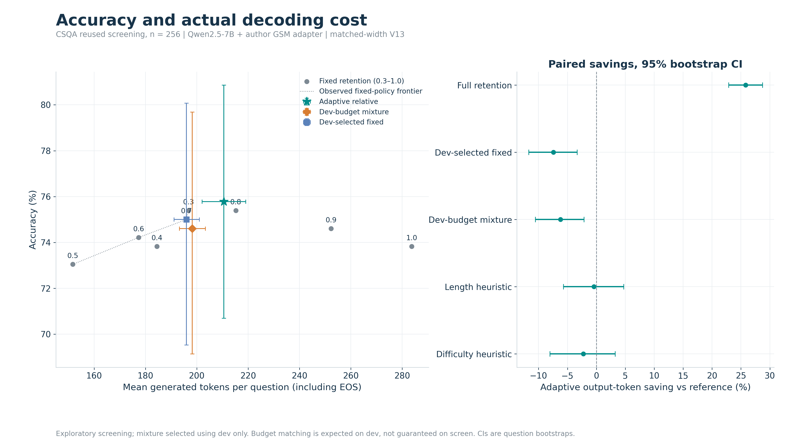
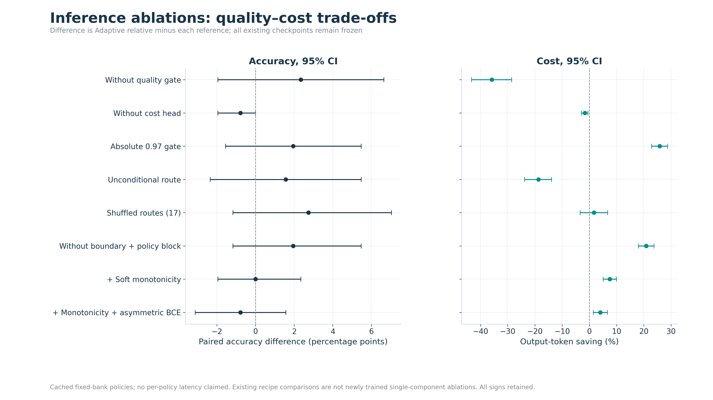
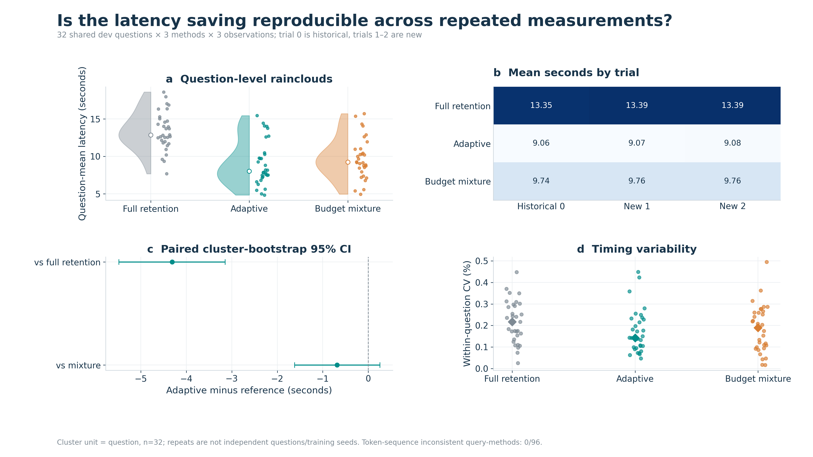

# SUFFICE

**When Is Less Thought Enough? Sufficiency-Gated Budget Allocation for Controllable Chain-of-Thought Compression**

Anonymous research code release.

SUFFICE selects a reasoning retention ratio **before decoding**. A frozen encoder reads the question prefix, a small probe predicts correctness and output-token cost for each ratio, and a relative sufficiency gate keeps candidates competitive with full retention on that same question. The unchanged generator then decodes **once** at the cheapest admitted ratio.

## Framework



- **(a) Offline outcome bank:** collect per-ratio correctness and realized output lengths on training questions.
- **(b) Prefix sufficiency probe:** predict sufficiency and cost from a ratio-independent prefix representation. The recoverability head supplies an auxiliary training signal and does not select the online action. Average predictions from three probe seeds.
- **(c) Sufficiency-gated allocation:** retain ratios with predicted sufficiency at least that of full retention, subject to an optional slack and a minimum allowed ratio. Always retain the full-retention fallback. Minimize predicted tokens within this set.
- **(d) Single decode:** pass the selected ratio to the existing generator. No online candidate decoding, answer checking, or retry search is used.

For zero slack, applying any strictly increasing transformation to a question's sufficiency scores leaves its admitted set unchanged. This is a property of the decision rule, not a guarantee that the predictions are correct.

The default probe has a 128-dimensional GELU trunk with dropout 0.15, eight sufficiency logits, eight auxiliary recoverability logits, and a reference-plus-offset log-cost head. Its ratio grid is `0.3, 0.4, ..., 1.0`; deployment admits ratios from `0.5` upward. Training seeds are `17, 43, 79`.

## Motivation



The manuscript's selected motivation figure illustrates why a single global ratio can waste tokens on some questions and remove needed reasoning on others. Its examples are illustrative case studies, not a separate aggregate evaluation. The selected v1 artwork is retained here.

## Results included in this release

The tables below are transcribed from the supplied experiment records. V13 uses **256 previously used CommonsenseQA screening questions**, Qwen2.5-7B-Instruct, and the upstream **GSM8K adapter**; this is not the CommonsenseQA-trained adapter from the TokenSkip paper. V13 holds padding width fixed across ratios and policies. These are exploratory screening results, not a fresh held-out benchmark rerun.

### Controlled accuracy and token cost

| Method | Correct / 256 | Accuracy (%) | Output tokens / question |
|:--|--:|--:|--:|
| Full retention, ratio 1.0 | 189 | 73.83 | 283.77 |
| Fixed ratio 0.5 | 187 | 73.05 | 151.72 |
| Dev-selected fixed ratio 0.7 | 192 | 75.00 | 195.99 |
| Dev-budget mixture, seed 17 | 191 | 74.61 | 198.21 |
| Length heuristic | 196 | 76.56 | 209.66 |
| Without learned cost | 196 | 76.56 | 207.15 |
| **SUFFICE / adaptive relative** | **194** | **75.78** | **210.53** |

Output-token counts include EOS. SUFFICE and fixed-ratio rows use actual generations; heuristic and ablation rows select outcomes from the cached fixed-ratio bank. Mixture parameters were selected on development data, so realized screening budgets need not match. The complete 29-method table, evaluation-mode flags, paired confidence intervals, and corrected tests are in `results/v13/all_29_methods_with_paired_statistics.csv`.

Relative to full retention, the observed token reduction is **25.81%**, with a paired 95% bootstrap interval of **22.86–28.71%**. The accuracy difference is **+1.95 percentage points**, with interval **−1.56 to +5.47**; it does not establish an accuracy improvement. The table also does not establish superiority over the simpler equal-budget alternatives.



### Inference ablations



Ablations include the quality gate, learned cost, previously trained probe recipes, and routing controls. Cached counterfactuals are identified in the result files; oracle rows use labels and are not deployable policies.

### Repeated latency

V14 evaluates **32 development questions, three trials per method**, for 288 observations in total. Trials repeat the same 32 questions; they are not 96 independent test questions. One trial was retained from the earlier run.

| Method | Questions | Observations | Mean seconds / question |
|:--|--:|--:|--:|
| Full retention | 32 | 96 | 13.3781 |
| Dev-budget mixture | 32 | 96 | 9.7539 |
| **SUFFICE / adaptive relative** | **32** | **96** | **9.0678** |

The measured time reduction versus full retention is **32.22%** (question-cluster 95% interval **24.13–39.78%**). The interval for the **7.03%** reduction versus the mixture includes zero (**−2.75 to +16.09%**). Timing includes routing overhead and is specific to the recorded hardware and runtime. Full values are in `results/v14/latency_summary.csv` and `latency_paired.csv`.



## Repository layout

```text
src/suffice/         Portable policy, checkpoint-compatible probe, prompts, routing CLI
scripts/            Dataset preparation, probe training, inference, result verification
configs/            Default policy and pinned dataset source revisions
research/src/       Preserved training, generation, evaluation, and diagnostic scripts
research/upstream/  Third-party answer extraction and grading helpers
research/figure_scripts/  Original V13 figure renderers
results/v13/        Aggregate V13 CSV tables
results/v14/        Aggregate V14 CSV tables
figures/            Framework, motivation, and selected results in PNG and PDF
tests/              Policy, checkpoint compatibility, and small CPU training checks
docs/               Reproduction details and source provenance
licenses/           Third-party license text
```

Datasets, question-level outputs, model weights, adapters, and trained probe checkpoints are excluded. Keep local assets in sibling directories such as `../SUFFICE-DATASETS` and `../SUFFICE-WORKSPACE`.

## Installation and checks

Use Python 3.10 or later for the portable package. The recorded GPU experiments used Linux, Python 3.11, PyTorch 2.4.0 with CUDA 12.1, Transformers 4.46.3, PEFT 0.13.2, and NumPy 1.26.4. Historical scripts using `fcntl` and Unix signal timeouts require Linux.

```bash
python -m venv .venv
# Activate the environment with the command appropriate for your shell.
python -m pip install -e .
python -m unittest discover -s tests -v

# Probe training and model/checkpoint tests:
python -m pip install -e ".[probe]"
python -m unittest discover -s tests -v

# Optional GPU inference, data preparation, and analysis dependencies:
python -m pip install -e ".[inference,data,analysis]"
```

Install the PyTorch build appropriate to the machine's CUDA runtime. Offline outcome-bank construction in `research/src/generate_bank.py` additionally uses vLLM; keep that historical generation environment separate from the lightweight CPU routing installation.

## Datasets: local preparation only

The downloader pins source revisions and records checksums. It refuses to write dataset payloads into this repository. Data remain subject to their source terms, retained in each downloaded dataset card.

| Benchmark | Training pool downloaded | Labeled evaluation set | Source identifier |
|:--|--:|--:|:--|
| GSM8K | 7,473 | 1,319 test | `openai/gsm8k` |
| MATH / MATH-500 | 7,500 MATH train | 500 MATH-500 test | `EleutherAI/hendrycks_math`, `HuggingFaceH4/MATH-500` |
| CommonsenseQA | 9,741 | 1,221 validation | `tau/commonsense_qa` |
| MMLU-STEM | MMLU auxiliary train | 3,018 across 18 STEM subjects | `cais/mmlu` |

The original 5,000-example MATH test set, CommonsenseQA's 1,140 unlabeled test examples, and complete MMLU dev/validation/test files are also retained locally. The labeled CommonsenseQA validation set is the paper's evaluation source; its official unlabeled test set is not scored as though labels were available.

```bash
python scripts/download_datasets.py --output ../SUFFICE-DATASETS
python scripts/prepare_datasets.py --root ../SUFFICE-DATASETS
```

`reconstructed_splits/` contains newly reconstructed splits using the preserved split constructor. These are separate from the original `historical/` experiment records. Source changes, ordering, and preprocessing can affect membership, so reconstruction is not claimed to reproduce historical IDs exactly. See `docs/REPRODUCIBILITY.md` for details.

## Train a probe

Training takes an external JSONL outcome bank and an aligned feature NPZ. It updates only the small probe, never the encoder or generator. Each row contains `id`, `split` (`train` or `dev`), and eight-element arrays `candidate_correctness`, `candidate_tokens`, and `actual_recoverability`. The last array uses K=3 Jeffreys-smoothed recovery labels: `(successes + 0.5) / 4`. The feature file contains matching `ids` and `features` arrays.

```bash
python scripts/train_probe.py --rows ../SUFFICE-DATASETS/historical/training/policy_predictions.jsonl --features ../SUFFICE-DATASETS/historical/training/shared_prefix_development_features.npz --output ../SUFFICE-WORKSPACE/probe_run --recipe soft_boundary --device cuda
```

This command requires the historical bank locally; it is not downloaded with the code release. For new data, the retained `generate_bank.py`, `score_bank.py`, and `embed_shared_prefix.py` implement retention/recovery construction, grading, and feature extraction. The assembly command in `docs/REPRODUCIBILITY.md` joins these artifacts into the training schema.

The default recipe retains the original six loss terms, train-only normalization and smearing, and three seeds. Use a new output directory for each run. Model state keys remain compatible with original V7 probe checkpoints.

## Route and decode

Route frozen prefix features without loading a generator:

```bash
suffice-route --features ../SUFFICE-WORKSPACE/query_features.npz --probe ../SUFFICE-WORKSPACE/probe_run/soft_boundary --output ../SUFFICE-WORKSPACE/routes.jsonl
```

Alternatively, `--predictions predictions.npz` accepts arrays named `ids`, `prob`, and `cost`, each prediction matrix having eight columns. This route uses no labels, answer traces, or recoverability values.

For portable Qwen-compatible one-decode inference, provide a **local merged ratio-controllable generator**, its matching tokenizer, and the **exact frozen feature encoder** used to train the probe:

```bash
python scripts/generate.py --input ../SUFFICE-WORKSPACE/questions.jsonl --encoder ../SUFFICE-WORKSPACE/models/encoder --generator ../SUFFICE-WORKSPACE/models/generator --probe ../SUFFICE-WORKSPACE/probe_run/soft_boundary --output ../SUFFICE-WORKSPACE/answers.jsonl
```

Questions contain `id` and `question`, with no answer labels. This convenience entry point handles one question at a time and makes one generator call per question. It performs a separate encoder pass without cache sharing across different models. Its runtime is not the source of the reported timing measurements. Exact V13 padding, LoRA-merge, and timing controls remain in `research/src/`.

## Verify the supplied aggregates

With the original question-level records stored locally:

```bash
python scripts/verify_result_tables.py --data-root ../SUFFICE-DATASETS
python scripts/check_release.py
```

Verification recomputes all 29 V13 method means and three V14 latency means. It does not rerun GPU generation or validate broader manuscript claims absent from these records. `docs/VALIDATION.md` records the checks performed for this release.

## Credits

The controllable generator interface and vendored answer-extraction/evaluation helpers build on **Github - hemingkx/TokenSkip**. Third-party notices and the upstream Apache 2.0 license are retained in `THIRD_PARTY_NOTICES.md` and `licenses/`. Dataset and pretrained-model identifiers describe external dependencies; no dataset or model payload is redistributed here.

Figures are displayed using local image sources. This README contains no author profiles, contact information, external hyperlinks, badges, or image links.
